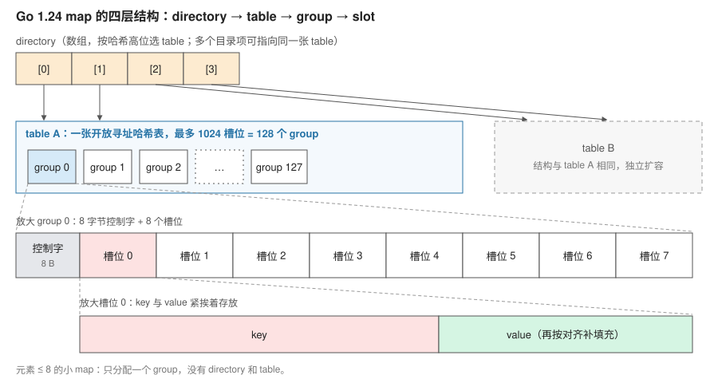
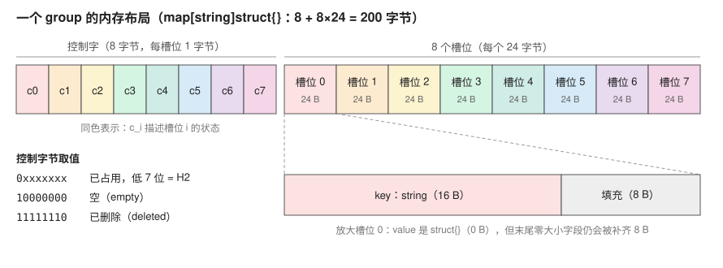
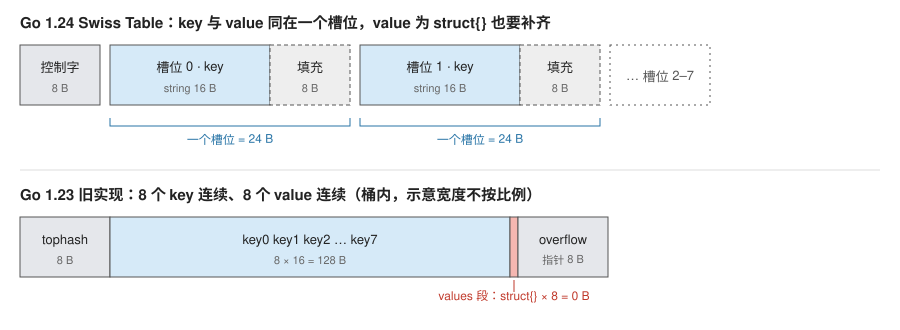
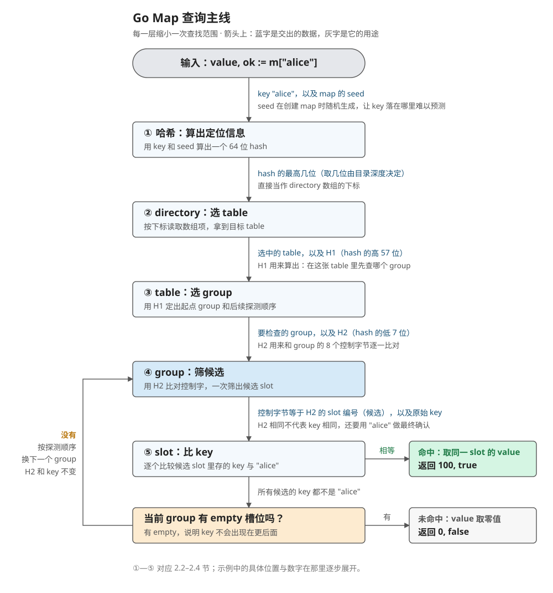
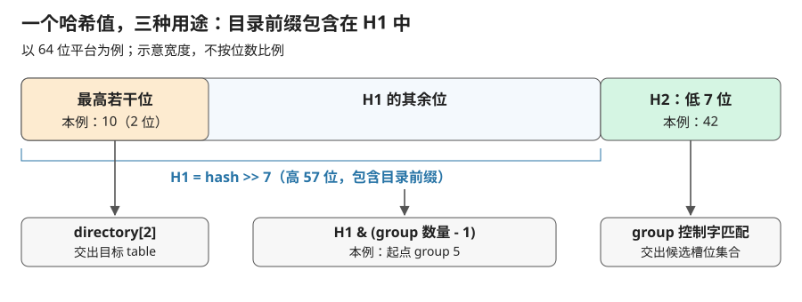
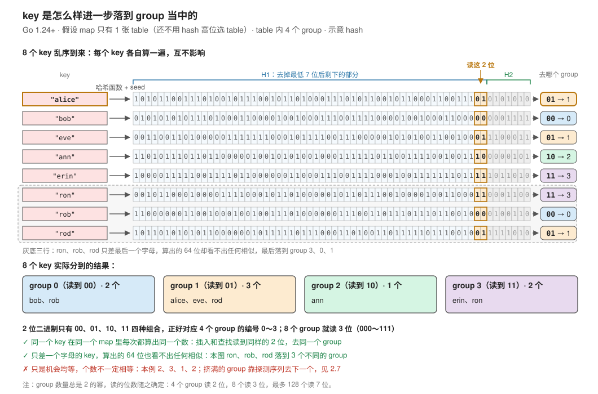
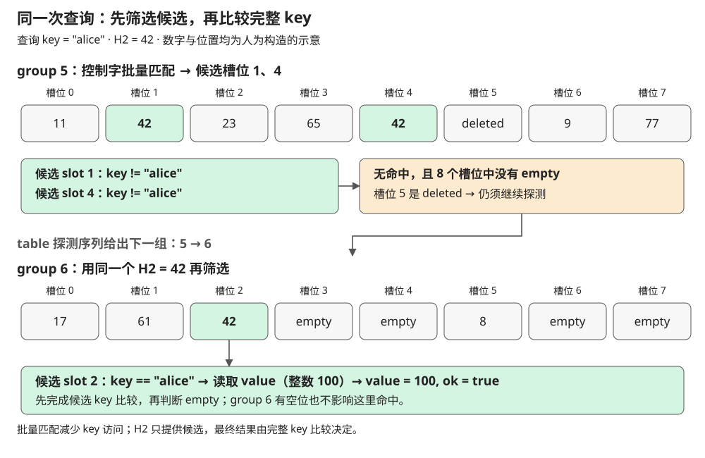
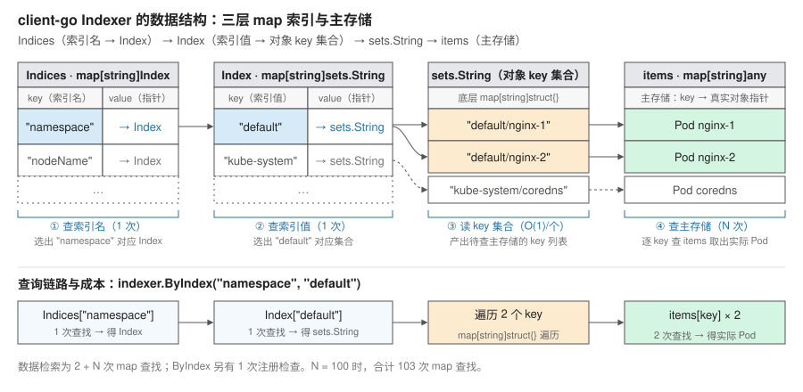

> [进入这篇文章的滚动叙事版 →](../../explore/go-map/)

**Kubernetes 用 `map[string]struct{}` 实现集合，空结构体真的能替它省下内存吗？**

map 常被当作“给 key、拿 value”的黑盒，那么实际项目中，都会怎么使用它呢？ 这一篇从 Kubernetes 的集合和 client-go 的索引出发，尝试解释清楚 Go Map 的数据结构。

> 源码版本：kubernetes/apimachinery v0.31.0、kubernetes/client-go v0.31.0；runtime 以 Go 1.24.0 默认启用的 Swiss Table 实现为主，对照 Go 1.23.0 的旧实现。本地实验使用 Go 1.25.5、macOS arm64。教学代码独立编写，不是项目源码的摘录。


## 1. 集合：Kubernetes 的 Set，数据存在哪里？

### 1.1 用法：用 map 实现集合

Go 没有内置的集合类型，最常见的做法是用 map 的 key 存元素、value 什么都不放。Kubernetes 的 apimachinery 就是这样定义集合的（[kubernetes/apimachinery/pkg/util/sets/set.go (23-34)](https://github.com/kubernetes/apimachinery/blob/v0.31.0/pkg/util/sets/set.go#L23-L34)）：

```go
type Empty struct{}

type Set[T comparable] map[T]Empty

func New[T comparable](items ...T) Set[T] {
    ss := make(Set[T], len(items))
    ss.Insert(items...)
    return ss
}
```
这几行里有两个值得深入探究的工程问题：

1. 类型参数要求 `T comparable`。为什么 map 的 key 必须可比较？
2. value 用的是空结构体 `struct{}`。通常的说法是“它不占空间”，在 map 里真是这样吗？

要回答这两个问题，需要先弄清 map 是怎样存放数据的。

### 1.2 哈希表的核心流程

不论哪种编程语言，哈希表的实现思路基本一致，那就是用哈希函数将key计算为一个数组下标，然后直接访问该数组下标读取结果。理想情况下一次访问就可以得到结果，这就是map快的原因。

> 数组的元素在内存中是紧密排列的，且占用大小相同，因此计算机获取直接用 “起始地址 + 索引 * 元素大小” 可以直接计算出对应的内存地址，访问是即时的 O(1)。

不过数组的位置是有限的，两个完全不同的数据，经过哈希函数计算后，得出了相同的数组索引，导致它们要抢占内存里的同一个位置，这叫**哈希冲突**。处理冲突主要有两种思路：

- **拉链法**：每个位置挂一串存储空间，冲突的 key 都挂在同一个位置下面。
- **开放寻址法**：位置被占了，就按一套固定规则去看下一个位置，直到找到空位。查找时按同样的规则走，就能找回来。

> 不管哪种思路，冲突的 key 最终都要靠逐个比较才能分清，这意味着：**map 需要对 key 做两件事：计算哈希，以及判断两个 key 是否相等。** 所以 key 必须是可比较的类型；slice、map、函数不能用 `==` 比较，也就不能当 key。

以上就是这个数据结构的大体实现，不论细节如何变动，都会以这个流程为主干延伸。

### 1.3 Go 1.24 换了实现

Go map 先后用过这两种思路。Go 1.23 及以前的实现接近拉链法：数据放在“桶”（bucket）里，桶满了就挂“溢出桶”。

> 关键词： hmap、bucket、overflow。

从 Go 1.24 开始，默认实现换成了基于 **Swiss Table** 的开放寻址法。[Go 1.24 发布说明](https://go.dev/doc/go1.24#runtime)、[官方博客：Faster Go maps with Swiss Tables](https://go.dev/blog/swisstable)

### 1.4 Swiss Table 的四层结构

它主要由四层结构组成，从大到小依次是：

- **directory**：一个数组，保存指向各张 table 的引用。map 先根据哈希值在目录里选出要访问的 table。
- **table**：由若干 group 组成，本身就是一张完整的开放寻址哈希表。单张 table 最多 1024 个槽位。
- **group**：8 个槽位为一组，外加一个 8 字节的**控制字**，每个字节对应一个槽位，记录它的状态。
- **slot**：保存一个 key 和它的 value，是真正存放数据的地方。

只有slot最终保存数据，其余三层都在帮忙定位key。为什么引入 directory 和 table 的分层？因为要保证**扩容搬迁时的延迟可以接受**。如果所有数据都放在单张大表里，包含大量元素的Map扩容一次就需要搬迁全部数据，会引发严重的延迟。因此，runtime 将单张 table 的上限固定为 1024 个槽位；当数据量超出时，拆分成多张独立的 table，由最顶层的 directory 数组作为索引统一寻址。



一个 group 在内存里是一块连续空间：前 8 字节是控制字，后面紧跟 8 个槽位。以 `map[string]struct{}` 为例（string 占 16 字节，槽位按 8 字节对齐后是 24 字节）：



另外，小 map 可以采用特殊表示：直接用一个 group 存放最多 8 个元素，省去 directory 和 table。但不能只凭当前 `len(m) <= 8` 判断内部表示：容量提示较大，或者曾经增长后又删除元素的 map，仍可能使用常规 table（[Go 1.24 map 实现](https://github.com/golang/go/blob/go1.24.0/src/internal/runtime/maps/map.go)）。

### 1.5 `struct{}` 真的不占空间吗？

关键在于槽位的布局：在 Swiss Table 里，**一个槽位就是一个 `{key, value}` 结构体**，key 和 value 紧挨着存放。编译器生成槽位类型的源码大致是（[golang/go/src/cmd/compile/internal/reflectdata/map_swiss.go (49-53)](https://github.com/golang/go/blob/go1.24.0/src/cmd/compile/internal/reflectdata/map_swiss.go#L49-L53)）：

```go
slotFields := []*types.Field{
    makefield("key", keytype),
    makefield("elem", elemtype),
}
slot := types.NewStruct(slotFields)
```

下面是两种实现中 8 个 `string` key 配 `struct{}` value 的排布：



槽位是一个结构体，它就要遵守 Go 结构体的内存对齐规则。**如果结构体的最后一个字段大小为 0，编译器会在末尾补齐填充**，以免指向这个字段的指针越过结构体边界。于是：

```go
unsafe.Sizeof(struct{ k string; v struct{} }{}) // 24，不是 16
unsafe.Sizeof(struct{ k string; v bool }{})     // 24
```

string 占 16 字节，按 8 字节对齐，无论 value 是 `struct{}` 还是 `bool`，槽位都是 24 字节。

旧实现不一样：它在一个桶里把 8 个 key 连续放在一起，再把 8 个 value 连续放在一起。value 是 `struct{}` 时，那一段的长度就是 0，确实不占空间。

实验分别用两种实现，往 map 里放 100 万个 string key，比较不同 value 类型带来的堆增长（key 的字符串内容事先分配，不计入）：

```sh
go run . memory
GOEXPERIMENT=noswissmap go run . memory   # 切回旧实现对照
```

| 100 万个条目 | `struct{}` | `bool` | 8 字节结构体 |
| --- | --- | --- | --- |
| Go 1.25.5 默认实现 | 53.2 MiB | 53.0 MiB | 53.2 MiB |
| Go 1.25.5 `noswissmap` | 38.2 MiB | 40.4 MiB | 55.3 MiB |

接下来深入研究一下 map 的查找过程。

## 2. 查找：一次 `m[key]` 怎样找到 value？

### 2.1 先看全过程：输入 key，经过哪些结构，输出什么？

假设有一张 `m map[string]int`，其中保存着 `"alice" → 100`。现在执行：

```go
value, ok := m["alice"]
```

这次查询的**输入是 map `m` 和 key `"alice"`，输出是对应的整数 value 与存在标记 ok**：命中时得到 `100, true`；不存在时得到 int 的零值 `0` 和 `false`。下面以这次查询为例说明。



各层是怎样交接的：

- **map** 保存 seed 和目录信息，为这次查找提供上下文。
- **directory** 是 table 引用数组，接收哈希前缀，查出目标 table。
- **table** 管理 group 数组及元数据，接收 H1，查出当前要检查的 group。
- **group** 把控制字和 8 个槽位放在一起，用 H2 筛出候选槽位编号。
- **slot** 保存 key 和 value，比较原始 key，相等时才交出 value。

因此，这条路径可以先读成：**输入 key → 获得定位信息 → 选 table → 访问 group → 筛 slot → 比 key → 返回 value 与 ok**。若当前 group 没找到，查询还要判断能否结束，或者在同一张 table 内继续探测。

这条路径在源码里就是一个函数。key 为 string 时，就是`runtime_mapaccess2_faststr` 的调用，伪代码如下（[Go 1.24.0：runtime_mapaccess2_faststr](https://github.com/golang/go/blob/go1.24.0/src/internal/runtime/maps/runtime_faststr_swiss.go#L162-L218)

```text
func runtime_mapaccess2_faststr(m *map[string]int, key string) (value int, ok bool) { // 省略：空 map、并发写检测、小 map
    hash = hash(key, m.seed)          // ① 用 key 和 seed 算 hash

    idx  = hash 的最高几位             // ② 用这几位选 table
    t    = m.directory[idx]

    seq  = 由 H1(hash) 定起点和探测顺序  // ③
    loop:
        g = t 的第 seq.offset 个 group

        候选 = g 中控制字等于 H2(hash) 的槽位   // ④
        for i in 候选:
            if g.slot[i].key == key:           // ⑤ 比较完整 key
                return g.slot[i].value, true   // 命中

        if g 里有 empty 槽位:                   // 候选耗尽
            return 零值, false                 // 未命中
        seq = seq 的下一个 group               // 没有 empty，继续探测
```

接下来沿这条路径展开，理解它解决的问题和实现。

### 2.2 ① 哈希：把 key 变成定位信息

从总览图的起点出发：

```go
value, ok := m["alice"]
```

**为什么先算哈希**：后面三层都要回答“key 在哪”，但 key 可能是任意长度的字符串，没法直接当数组下标。所以第一步先把 key 换算成一个固定 64 位的整数，而且**只算一次**：后面每一层都从这一个值里取自己需要的部分，直到最后比较 key 之前，都不必再读字符串内容。

**seed 解决什么问题**：如果哈希函数固定，攻击者可以事先算好一批落在同一位置的 key，让 map 的查找退化成逐个比较。因此每个 map 在创建时生成自己的随机 seed，参与哈希计算，使 key 的位置难以预测。即使查询同一个字符串，换一个 map 也不能假定得到相同位置。

**怎么实现**：

```go
// map.go：创建 map 时生成 seed
m.seed = uintptr(rand())

// 查找时：key 和 seed 一起算出 hash
hash := typ.Hasher(key, m.seed)

// 从同一个 hash 里取出 H1、H2
func h1(h uintptr) uintptr { return h >> 7 }   // 高 57 位
func h2(h uintptr) uintptr { return h & 0x7f } // 低 7 位
```

对应源码见 [Go 1.24.0：Map.seed](https://github.com/golang/go/blob/go1.24.0/src/internal/runtime/maps/map.go#L200-L201) 与 [h1、h2](https://github.com/golang/go/blob/go1.24.0/src/internal/runtime/maps/map.go#L183-L192)。对于 string key，哈希需要处理字符串内容，长 key 通常会增加这部分成本。得到哈希后，同一个结果被用于三件事：

- **哈希最高的若干位**：用来选择 directory 项，取多少位由目录深度决定。
- **H1，即高 57 位**：`hash >> 7`，用来生成 table 内的 group 探测序列。
- **H2，即低 7 位**：`hash & 0x7f`，用来在 group 内筛选候选槽位。

注意，高位目录前缀本来就在 H1 里面。这里是**一个哈希值的不同取法**，不能把“目录高位、H1、H2”理解成互不重叠的三段。



### 2.3 ② directory：用哈希高位选出一张 table

**为什么需要 directory**：1.4 提过，单张 table 扩容时要把全部 key 一次性重放，表越大，触发扩容的那次插入就越慢（为什么只能一次性重放，下一篇细说）。所以 runtime 把单张 table 限制在 1024 个槽位，数据多了就拆成多张。拆开之后，查找得先知道 key 在哪一张，**directory 就是这张索引**：以 hash 前缀为下标，直接取出对应的 table，它本身不存 key/value。

**怎么选出 table**：继续这次查询。directory 的长度总是 2 的幂，`目录长度 = 1 << 目录深度`。目录深度（`globalDepth`）就是选 table 要用掉 hash 的几位：只有一张 table 时深度为 0，不用选；某张 table 拆分、目录跟着翻倍时，深度加 1。本例深度为 2，directory 有 4 项，下标正好是 `00`、`01`、`10`、`11`。

下标来自一次右移：`hash >> (64 - 目录深度)`，只留下最高的那几位。本例是 `hash >> 62`，示意 hash 的最高两位是 `10`，得到下标 2。源码就是这一行（[Go 1.24.0：directoryIndex](https://github.com/golang/go/blob/go1.24.0/src/internal/runtime/maps/map.go)）：

```go
func (m *Map) directoryIndex(hash uintptr) uintptr {
	if m.dirLen == 1 {
		return 0
	}
	return hash >> (m.globalShift & 63) // 64 位平台上 globalShift = 64 - globalDepth
}
```

`directory[2]` 里是一张 table 的引用，按数组下标一步读出，不用遍历：

![目录前缀选 table：示意 hash 的最高 2 位为 10，右移 62 位得到下标 2，读取 directory[2] 拿到目标 table；还没拆分的 table A 同时被下标 0 和 1 引用](assets/map-directory-index.svg)

目录项和 table 不是一一对应：还没拆分的 table A 同时被 `00` 和 `01` 指向，`10` 指向的 table B 已经拆过，独占 `directory[2]`，所以下标 2 不是“第 2 张 table”。目录怎样随 table 拆分而变化，见下一篇的 1.4 节。另外，directory 用的是 hash 最高的几位，table 内部选 group 用的是 H1 最低的几位，两者不重叠。

directory 到这里就完成了工作：**它接收哈希前缀，交出 table，不负责比较 `"alice"`，也不直接返回整数 value。**

到这里的交接结果是：`"alice" + seed → hash → directory[2] → table 引用`。原始 key、H1 和 H2 都还要保留，下一层会继续使用。

### 2.4 ③ table：用 H1 决定 group 的访问顺序

**为什么这样设计**：拿到 table 后，查找范围就固定在这张表里了。table 本身是一张完整的开放寻址哈希表：key 有一个首选位置，被占了就按固定规则去看下一个位置。Swiss Table 的不同之处在于，**探测的单位是 group，而不是单个槽位**：每走一步都检查一整组 8 个槽位（由 ④ 的控制字完成），所以 table 只需要决定“按什么顺序访问 group”。

**起点怎么算**：table 用 H1 的最低几位当 group 编号，`起点 = H1 & mask`，其中 `mask = group 数量 - 1`。下图用一张 4 个 group 的 table 演示任意 key 怎样落到某个 group：



各 group 被选中的机会均等，分到的 key 却不一定一样多，总有 group 先被装满。起点 group 满了，key 就要去后面的 group，所以 table 交出的不只是一个起点，而是一整条访问顺序。

group 数量总是 2 的幂，这带来两个好处：

- 求起点时，取模可以换成更便宜的按位与：`H1 % n` 等价于 `H1 & (n - 1)`。
- 步长依次为 1、2、3……时，探测序列恰好不重不漏地访问每个 group 一次，只要 table 里还有空位就一定能走到。源码注释原话是：“this probe sequence visits every group exactly once if the number of groups is a power of two”。

**怎么实现**：本例 table 有 8 个 group，mask 为 7，读 H1 的最低 3 位。用 2.3 的示意 hash 计算，H1 = hash >> 7，它的最低 3 位就是 hash 的第 7–9 位 `101`：

```text
mask       = 8 - 1 = 7 = 0b111
起点 group = H1 & mask = 0b101 = 5
```

```go
// table.go
func makeProbeSeq(hash uintptr, mask uint64) probeSeq {
	return probeSeq{
		mask:   mask,
		offset: uint64(hash) & mask, // 起点：H1 & (group 数量 - 1)
		index:  0,
	}
}

func (s probeSeq) next() probeSeq {
	s.index++
	s.offset = (s.offset + s.index) & s.mask // 依次多跳 1、2、3……个 group，超出末尾绕回开头
	return s
}
```

源码见 [Go 1.24.0：probeSeq](https://github.com/golang/go/blob/go1.24.0/src/internal/runtime/maps/table.go#L1125-L1155)。table 这一层接收 H1，结合自身的 group 数量生成探测序列，并交出第一个 group。它此时只知道“先检查 group 5”，还不知道目标在哪个槽位；H2 也还没派上用场。

到这里，查询已经从 `"alice"` 缩小到**一张 table 里的 group 5**。接下来才开始检查这一组的槽位。

### 2.5 ④ group：用控制字筛出候选 slot

**为什么需要控制字**：传统开放寻址每探测一个槽位，都要读出 key 做一次相等比较。对 string key 来说，这意味着先读槽位里的字符串头，再跳到字符串数据所在的内存逐字节比较；探测几个槽位，就要比较几次。

Swiss Table 的核心想法是**先用一个很小的“指纹”排除绝大多数槽位**。每个槽位配 1 字节的控制字节，记录 key 哈希的 7 位（H2）；8 个控制字节紧挨着，凑成一个 64 位整数，一次运算就能同时检查 8 个槽位，只有指纹相同的槽位才需要读 key。源码注释的说法是（[Go 1.24.0：map.go](https://github.com/golang/go/blob/go1.24.0/src/internal/runtime/maps/map.go#L44-L62)）：

> A swiss table utilizes the extra control word to check all 8 slots in parallel. … we effectively perform 8 steps of probing in a single operation.
>
> （Swiss Table 利用额外的控制字并行检查全部 8 个槽位……相当于用一次操作完成了 8 步探测。）

**为什么 H2 是 7 位**：一个字节有 8 位，要留 1 位区分“已占用”和“empty/deleted”，剩下的 7 位才能放指纹。每个槽位只多花 1 字节，8 个槽位的控制字节正好装进一个 64 位寄存器。

**怎么实现**：回想 1.4 的布局，一个 group 有 8 个槽位，前面放着 8 字节控制字，每个控制字节对应一个槽位，编码如下（[Go 1.24.0：ctrl](https://github.com/golang/go/blob/go1.24.0/src/internal/runtime/maps/group.go#L109-L117)）：

```go
// group.go
//	  empty: 1 0 0 0 0 0 0 0   // 0x80，从未使用
//	deleted: 1 1 1 1 1 1 1 0   // 0xFE，删除后留下的墓碑
//	   full: 0 h h h h h h h   // 最高位为 0，其余 7 位是该 key 的 H2
type ctrl uint8
```

写入 key 时把 H2 存进对应的控制字节，查询时用目标 H2 和这些控制字节匹配。

本例的目标 H2 为 42。进入 group 5 后，runtime 先检查控制字，得到候选槽位 1 和 4，再去读取这两个槽位中的 key。下面的图继续使用同一组示意数据：



这一层的输出只是“哪些槽位值得比较”。**H2 相同不代表 key 相同**；在哈希近似均匀的前提下，无关 key 的 H2 恰好相同的概率约为 1/128，因而可以提前过滤大部分槽位。源码注释给出的估算是：即使负载较高，每次查找平均需要做的“白比较”也不到 1/8 次（[Go 1.24.0：table.getWithKey 注释](https://github.com/golang/go/blob/go1.24.0/src/internal/runtime/maps/table.go#L166-L193)）。

控制字紧凑地放在一起，runtime 可以批量完成筛选。Go 1.24.0 的通用实现使用 **SWAR**（SIMD-within-a-register），核心只有两行；amd64 上则替换为 SIMD 指令实现：

```go
// group.go
func ctrlGroupMatchH2(g ctrlGroup, h uintptr) bitset {
	v := uint64(g) ^ (bitsetLSB * uint64(h))          // 把 H2 复制到 8 个字节再异或：匹配的字节变成 0
	return bitset(((v - bitsetLSB) &^ v) & bitsetMSB) // 找出为 0 的字节，把它的最高位标记为 1
}
```

这种通用位运算偶尔会多报候选，但不会漏报；多出来的候选在下一步被完整 key 比较排除，不影响正确性（[Go 1.24.0：matchH2 与通用实现](https://github.com/golang/go/blob/go1.24.0/src/internal/runtime/maps/group.go#L145-L166)）。

理解这一层时，重点是**先读紧凑的控制信息，再访问少量候选槽位中的 key**，不必逐个读取 8 个槽位里的字符串。这减少了不必要的 key 访问和相等比较，但不能据此保证具体的缓存命中情况。

### 2.6 ⑤ slot：比较完整 key，相等才取出 value

**为什么这样设计**：H2 只有 7 位，只能用来“排除”，不能用来“确认”，所以最后一步必须比较完整 key。另一个设计点是 **key 和 value 挨着放在同一个槽位里**（1.5 讲过它的内存代价）。源码注释说明了这样做的目的：“keys and elements are interleaved to maximize locality”，即 key 比较完，value 就在旁边，不用再跳到另一块内存去读（[Go 1.24.0：table.groups 注释](https://github.com/golang/go/blob/go1.24.0/src/internal/runtime/maps/table.go#L67-L70)）。

**怎么实现**：string key 的专用路径里，可以直接看到“比完 key，紧接着取 value”：

```go
// runtime_faststr_swiss.go
slotKey := g.key(typ, i)
if key == *(*string)(slotKey) {
	// value 紧跟在 key 后面：string 头部占 2 个指针宽（64 位平台上 16 字节）
	slotElem := unsafe.Pointer(uintptr(slotKey) + 2*goarch.PtrSize)
	return slotElem, true
}
```

拿到候选集合后，runtime 按候选编号定位槽位，将其中的 key 与查询 key `"alice"` 比较。本例在 group 5 中的比较结果是：

```text
槽位 1：H2 = 42，但 key != "alice" → 排除
槽位 4：H2 = 42，但 key != "alice" → 排除
```

这解释了为什么查询始终要带着原始 key：哈希负责定位和筛选，无法替代相等判断。对于 string，长度不同等情况可以提前排除，并非每次都要逐字节比较到底。

如果候选槽位里的 key 相等，就读取同一槽位中的 value。对这次 `m["alice"]` 而言，value 是整数 `100`。源码中的组内循环可见 [table.getWithKey](https://github.com/golang/go/blob/go1.24.0/src/internal/runtime/maps/table.go#L166)。

### 2.7 候选耗尽以后：结束，还是继续探测？

group 5 的候选已经全部排除。现在要检查的不是“有没有候选”，而是**这个 group 有没有 empty 槽位**：

- **有 empty**：可以结束，返回未找到；这里必须先完成当前 group 的候选比较。
- **没有 empty**：目标可能在后面的 group，由 table 的探测序列给出下一个位置，再重复“筛候选 → 比 key”的过程。

本例 group 5 的槽位 5 是 `deleted`，其余槽位均已占用，因此没有 empty，必须继续。**deleted 不能当作查询终点**：它可能原先存过数据，后续 key 可能已经越过这个 group。删除时保留这个标记，正是为了避免查询提前停止（[Go 1.24.0：探测与删除约束](https://github.com/golang/go/blob/go1.24.0/src/internal/runtime/maps/map.go#L62-L82)）。

为什么 empty 可以让查询结束？因为插入和查询使用同一条探测序列。一个 key 只有在前面的 group 没有可用位置时，才会被放到后面；删除又会保留必要的 deleted 标记，所以遇到真正的 empty，就无需再往后找。

这个规则还依赖另一个约束：**table 永远不会被填满**。table 的负载上限是 7/8（`maxAvgGroupLoad = 7`，与 Abseil 相同），占用槽位加上墓碑超过这个比例就会扩容或拆分，因此探测序列总能遇到 empty，查询不会无限循环。源码注释把它列为探测的不变量：“the end of a probe sequence must be a group with an empty slot (the table can never be 100% full)”（[Go 1.24.0：map.go Probing](https://github.com/golang/go/blob/go1.24.0/src/internal/runtime/maps/map.go#L64-L72)）。对应的代码就是 2.1 主干末尾的那几行：

```go
match = g.ctrls().matchEmpty()
if match != 0 {
	// Finding an empty slot means we've reached the end of
	// the probe sequence.
	return unsafe.Pointer(&zeroVal[0]), false
}
```

Go 1.24.0 使用二次探测：从起点开始，依次跳 1、2、3、4……个 group，超出末尾就绕回开头。当前 table 有 8 个 group，从 group 5 出发的完整顺序是：

```text
5 → 6 → 0 → 3 → 7 → 4 → 2 → 1
   +1  +2  +3  +4  +5  +6  +7
```

group 数量为 2 的幂时，这条序列能够遍历所有 group；但查询遇到命中或 empty 就会提前结束，不需要真的走完。实现见 [probeSeq.next](https://github.com/golang/go/blob/go1.24.0/src/internal/runtime/maps/table.go)。

本例只需再走一步：到达 group 6，用同一个 H2 = 42 筛出槽位 2，比较发现 `slot[2].key == "alice"`，于是取出该槽位的整数 `100`。runtime 将找到的元素交回上层，Go 表达式最终得到 `value = 100` 和 `ok = true`。若一路检查到 empty 仍未命中，则表达式得到 `value = 0` 和 `ok = false`。

### 2.8 回看：把每层的输入与输出连起来

现在回到 2.1 的总览图，把这次查找实际经过的交接重新列出来：

| 经过的结构 | 本次输入 | 做了什么 | 交出的结果 |
| --- | --- | --- | --- |
| 哈希计算 | `"alice"`、map 的 seed | 计算 hash，提取目录前缀、H1、H2 | 目录前缀 `10`、起点所需的 H1、H2 = 42 |
| directory：table 引用数组 | 目录前缀 `10` | 读取 `directory[2]` | 目标 table 的引用 |
| table：group 数组及元数据 | H1、8 个 group | 用 `H1 & 7` 求起点，生成探测序列 | 先 group 5，需要时再 group 6 |
| group：控制字 + 8 个 slot | H2 = 42、当前控制字 | 批量筛选候选；候选耗尽后检查 empty | group 5 给出候选 1、4；group 6 给出候选 2 |
| slot：key + value | 候选编号、原始 key `"alice"` | 定位槽位，比较完整 key，相等时读取 value | group 6 的 slot 2 返回整数 `100` |
| `m["alice"]` 表达式 | 上述单次 map 查找结果 | 取得 value 和存在标记 | `value = 100`、`ok = true` |

这些定位数字仍是同一组示意数据。到此可以把各层的职责连成一句话：**directory 缩小到 table，table 按序交出 group，控制字缩小到候选 slot，slot 用完整 key 确认并交出 value。** 每层都把定位结果交给下一层，直到在 slot 中读到这张 map 的 value。

## 3. 索引：client-go 的 Indexer 怎样组合多次 map 查找？

### 3.1 用法：用嵌套 map 建倒排索引

现在再看一个实际用法。Indexer 没有改变原生 map 的查找机制，它通过组织几张 map，把“按属性找对象”的请求转化成一系列 map 访问。

Kubernetes 的控制器需要频繁回答这类问题：“default 命名空间下有哪些 Pod？”如果每次都遍历全部对象，代价太高。client-go 的 Indexer 用嵌套 map 建了索引（[kubernetes/client-go/tools/cache/index.go (94-100)](https://github.com/kubernetes/client-go/blob/v0.31.0/tools/cache/index.go#L94-L100)）：

```go
type Indexers map[string]IndexFunc  // 索引名 → 计算索引值的函数
type Indices  map[string]Index      // 索引名 → 索引
type Index    map[string]sets.String // 索引值 → 对象 key 的集合
```

三层 map 的结构与检索关系如下：



以最常用的命名空间索引为例，数据大致长这样：

```text
Indices["namespace"]["default"] = {"default/nginx-1", "default/nginx-2", ...}
```

### 3.2 沿一次索引查询走完这几张 map

调用 `indexer.ByIndex("namespace", "default")` 时，输入是索引名和索引值，输出是对象列表与错误。正常路径是：

1. 用 `"namespace"` 读取 `indexers map[string]IndexFunc`，确认索引已注册；未注册时返回错误。查询已经给出了索引值 `"default"`，因此这里不需要调用索引函数重新计算它。
2. 用 `"namespace"` 读取 `indices map[string]Index`，得到命名空间索引 `index`。
3. 用 `"default"` 读取 `index map[string]sets.String`，得到对象 key 集合，例如 `{"default/nginx-1", "default/nginx-2"}`。
4. 遍历集合，把每个对象 key 交给 `items map[string]interface{}` 查询，将取出的对象追加到列表，返回 `objects, nil`。索引已注册但集合为空时，返回空列表。对应源码见 [client-go v0.31.0：getKeysByIndex 与 ByIndex](https://github.com/kubernetes/client-go/blob/v0.31.0/tools/cache/thread_safe_store.go)。

第 1、2、3 步以及第 4 步中的每次 `items[key]` 都是原生 map 查找，可以用前面建立的结构来理解；具体是否采用常规 table 路径，取决于各张 map 的内部表示。`sets.String` 本身也是 map，但这里对它执行的是遍历，不是按 key 逐项查询集合。

### 3.3 为什么索引里存对象 key，而不直接存对象？

这是一种倒排索引设计：`indices` 先按索引名区分查询维度，`Index` 再把一个属性值映射到对象 key 集合。比如 `"default"` 对应所有属于该命名空间的对象 key。这样，查询时就不必遍历主存储里的全部对象，逐个检查命名空间。

对象本身统一放在 `items` 中，索引保存用于回查的 key。同一个对象可以出现在不同索引或不同索引值对应的集合里，各处都通过对象 key 回到主存储。集合则让同一索引值下的对象 key 保持唯一。代价是索引占用额外内存，而且新增、更新、删除对象时，都需要同步维护索引；查询取到集合后，还要逐个回查对象。

若结果集合有 N 个对象，数据检索需要 `2 + N` 次 map 查找，此外还有 1 次索引注册检查。原生 map 查找解释了其中每一步怎样定位数据，Indexer 的设计解释了为什么要组织这些步骤。整体开销还取决于 key 长度、命中情况与结果集合大小。

一次查找也依赖 table 保留足够空位。元素越来越多时，这些空位怎样维持？下一篇从 Datadog 的内存变化继续看增长与删除。
