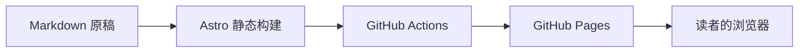

这是一篇普通的 Markdown 文章。它不需要 React 交互组件，也不需要手写页面路由。

## 一篇文章如何抵达读者

下面的流程图由 Mermaid 源码生成。图表和文章一起保存在版本库里。

## 一张 SVG，也是一份文档

图片与 Markdown 放在同一目录，构建时会生成正确的资源地址。

## 写下一篇

在 `src/content/blog/` 中新增 `.md` 文件，填写标题、描述与日期，文章列表和独立页面会在下次构建时自动生成。
